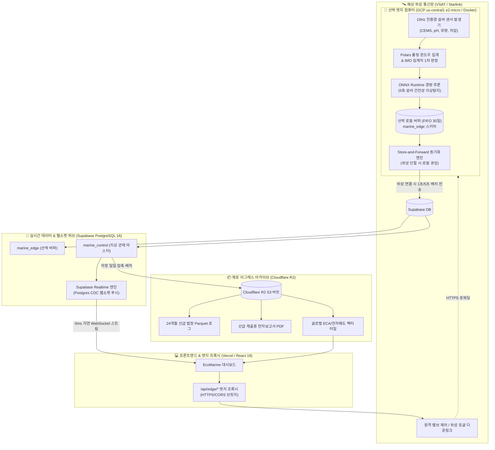

# EcoMarine GIS (해양 친환경 설비 위성 원격 관제 플랫폼)

> **파나시아(PANASIA) 친환경 설비(PaSOx Scrubber / GloEn-Patrol BWTS) 위성 원격 관제 및 IMO/선급 표준 텔레메트리 플랫폼**

[](https://github.com/initbtn/marine-sensor-gis/actions/workflows/ci.yml)
[](https://www.typescriptlang.org/)
[](https://react.dev/)
[](https://leafletjs.com/)
[](https://echarts.apache.org/)
[](https://cloud.google.com/)
[](https://supabase.com/)
[](https://www.cloudflare.com/developer-platform/r2/)
[](https://vercel.com/)

---

## 1. 프로젝트 개요 (Overview)

**EcoMarine GIS**는 글로벌 해양 친환경 설비 선도기업인 **파나시아(PANASIA)**의 친환경 솔루션(ES) 장비를 대상으로, 국제해사기구(IMO)와 주요 선급(KR, DNV, ABS 등)의 엄격한 환경 규제를 실시간으로 감시하고 위성 통신 단절 시에도 데이터 무결성을 보장하는 **산업용 해양 GIS 위성 원격 관제 웹 플랫폼**입니다.

### 핵심 관제 설비 및 규제 기준
1. **PaSOx (선박 배기가스 탈황 스크러버 — IMO MARPOL Annex VI & MEPC.340(77))**
   - 배기가스 황산화물(SOx) 농도: 일반 해역 $\le$ 21.7 ppm (0.5% S), ECA 규제 해역 $\le$ 4.3 ppm (0.1% S)
   - 세정수 선외 배출 환경 기준: 배출수 **pH $\ge$ 6.5 강제 감시**, 탁도(Turbidity) $\le$ 25 NTU, PAH $\le$ 50 ppb
2. **GloEn-Patrol (선박 평형수 처리 설비 — IMO BWM Convention Reg. D-2)**
   - 평형수 살균 유효성: 자외선(UV) 조사 강도 $\ge$ 250 W/m², 소독 잔류 산화제(TRO) 중화 배출 $\le$ 0.1 ppm
   - 운전 안전 인터록: 여과기 전후 차압(Filter DP $\ge$ 1.0 bar 자동 역세척), 정격 처리 유량(TRC) 감시
3. **PaCCUS (선박 탄소 포집 및 저장 설비, OCCS)**
   - IMO 2030/2050 온실가스 감축(Net-Zero) 대응 CO2 포집률(%) 추적 인터페이스

---

## 2. 4대 클라우드-엣지 인프라 아키텍처 (Cloud-Edge Architecture)

선박의 열악한 위성 통신 환경과 IACS UR E26/E27 사이버 복원력 표준을 충족하기 위해 **선박 온보드 로컬 에지(GCP VM)**, **실시간 데이터 허브(Supabase)**, **법정 24개월 무과금 아카이브(Cloudflare R2)**, **엣지 프록시 웹앱(Vercel)**의 4대 인프라 유기적 결합 아키텍처를 채택했습니다.



> 📖 **상세 아키텍처 명세서**: [`docs/spec/maritime-cloud-edge-architecture.md`](./docs/spec/maritime-cloud-edge-architecture.md)

---

## 3. 4대 운영 계정 맞춤형 대시보드 (Multi-Role Dashboards)

접속 계정의 직무와 목적에 따라 최적화된 시각화 레이아웃으로 실시간 동적 전환됩니다:

| 계정 역할 | 주요 목적 | 핵심 시각화 위젯 및 차트 |
|---|---|---|
| **1. 🚢 선박 기관사**<br>*(Chief Engineer)* | 설비 중심 0ms 무지연 계측 및 비상 알람 즉각 조치 | • **원형 게이지 (Circular Gauge)**: SOx ppm, 배출수 pH<br>• **초 단위 고주파 실시간 차트 (Line)**: 1초 펄스 파형<br>• **원클릭 알람 조치(Acknowledge) 콘솔** 및 에지 큐 인디케이터 |
| **2. 🏢 육상 관제관**<br>*(Fleet Operator)* | 전 세계 대양 선단 운항 위치 및 친환경 설비 총괄 관제 | • **해양 GIS 관제 지도 (Leaflet)**: 선수각(Heading) 회전 마커, 24시간 항적, ECA 규제 해역 오버레이<br>• **선단 상태 도넛 차트 (Doughnut)**: 정상/주의/위반 선박 분포<br>• **선단 누적 배출량 막대 차트 (Bar)** |
| **3. ⚖️ 규제 감사관**<br>*(Compliance Officer)* | IMO 및 선급(Class) 검사관 대상 법정 규제 준수율 증빙 | • **IMO 종합 준수율 게이지 (%)** (목표 99.5% 대비 달성률)<br>• **위반 발생 히트맵 매트릭스 (Heatmap)** (요일/시간대별 패턴)<br>• **선급 승인 전자 기록부 (ERB Table)** 및 CSV 내보내기 |
| **4. 🔧 원격 진단원**<br>*(Pan-Hawk Tech)* | 파나시아 육상 서비스 센터 비대면 예지보전 A/S | • **설비 건전성 5축 레이더 차트 (Radar)**: CEMS 신뢰도, 필터 차압 여유, UV 수명, 펌프 효율, 중화제 안정도<br>• **상관관계 산점도 (Scatter)**: 처리 유량 대비 차압 곡선<br>• **소모품 교체 예지보전 타임라인** |

---

## 4. 데이터 시각화 디자인 시스템 (Design System)

**IBM Carbon Design System**의 고대비 엔터프라이즈 데이터 시각화 표준과 **ISA-101 / IEC 62288** 고성능 HMI 규율을 융합한 해양 전용 다크 테마를 적용했습니다:

- **Deep Marine Background**: `#0B132B` / `#1C2541` (관제실 최적화 심해 네이비)
- **Eco Cyan (Brand / Compliant)**: `#00F5D4` / `#48CAE4` (친환경 정상 상태)
- **Warning Amber**: `#FF9F1C` (임계치 접근 경보)
- **Critical Crimson**: `#E71D36` (IMO 규제 초과 위험 / 1Hz 미확인 경보 점멸)
- **Zero Decorative Animation**: 시각 피로 및 알람 인지 방해를 원천 차단하기 위해 회전 팬, 유동 펄스 등 장식용 애니메이션을 배제하고 정적 고대비 색상으로 상태 전달.

---

## 5. 기술 스택 (Tech Stack)

| 영역 | 기술 스택 | 비고 |
|---|---|---|
| **Frontend Framework** | React 19, TypeScript, Vite | 컴포넌트 주도 개발 (CDD), Vercel 배포 |
| **Edge Reverse Proxy** | Vercel Serverless / Rewrites (`/api/edge`) | HTTPS 혼합 콘텐츠 방지 및 제어 다운링크 |
| **GIS & Mapping** | Leaflet, React-Leaflet | 선수 침로 회전 렌더링, 항적 폴리라인, ECA 해역 |
| **Data Visualization** | Apache ECharts, echarts-for-react | 8대 시각화 제품군 (게이지, 시계열, 레이더, 히트맵 등) |
| **Edge Computer** | GCP GCE `e2-micro` (Docker, Python 3.11) | Polars, FastAPI, ONNX Runtime (Always Free $0) |
| **Backend & Cloud DB** | Supabase (PostgreSQL 16), PostGIS | 2중 스키마 (`marine_edge` ⇄ `marine_control`) + Realtime |
| **Object Storage** | Cloudflare R2 (S3-compatible) | 법정 24개월 Parquet 아카이브, 전자해도 타일 (Zero Egress) |
| **Testing & CI** | Vitest, Testing Library, JSDOM, GitHub Actions | 100% TDD 커버리지 파이프라인 |

---

## 6. 시작하기 (Getting Started)

### 사전 요구사항
- Node.js `v18.19.1` 이상
- npm `9.2.0` 이상

### 1) 의존성 설치
```bash
npm install
```

### 2) 로컬 개발 서버 기동
```bash
npm run dev
```

### 3) 단위 테스트 및 빌드 검증
```bash
# Vitest 단위 테스트 (TDD)
npm run test

# TypeScript 타입 검사
npm run type-check

# 프로덕션 빌드
npm run build
```

---

## 7. 프로젝트 문서 및 거버넌스

- **기획 정본 명세서**: [`docs/project-planning.md`](./docs/project-planning.md)
- **4대 인프라 아키텍처 명세서**: [`docs/spec/maritime-cloud-edge-architecture.md`](./docs/spec/maritime-cloud-edge-architecture.md)
- **선급 및 IMO 표준 인증 가이드**: [`docs/domain/maritime-class-standards.md`](./docs/domain/maritime-class-standards.md)
- **실무자 도메인 UX 규율 가이드**: [`docs/domain/maritime-ux-rules.md`](./docs/domain/maritime-ux-rules.md)
- **데이터 시각화 매트릭스 명세서**: [`docs/spec/data-visualization-matrix.md`](./docs/spec/data-visualization-matrix.md)
- **파이썬 데이터 시각화 트렌드**: [`docs/spec/python-data-viz-trend.md`](./docs/spec/python-data-viz-trend.md)
- **프론트엔드 스토리보드 및 스펙**: [`docs/front-spec.md`](./docs/front-spec.md)
- **GitHub Projects v2 보드**: [Marine Sensor GIS Project Board (#2)](https://github.com/users/initbtn/projects/2)
- **프로젝트 체인지 플로우 규율**: [`change-flow-adapter.md`](./change-flow-adapter.md)

---

## 8. 스크럼 스프린트 보고서 체계 (Scrum Sprint 2-Track Reports)

| 스프린트 | 마일스톤 주제 | 에이전트 리포트 (MD) | 팀원 공유용 슬라이드 | 상태 |
|---|---|---|---|---|
| **Sprint 1** | **도메인 UX 규율 & 4대 직무 스토리보드** | [Sprint 1 Report](./docs/scrum/sprint-1-report.md) | [Sprint 1 Slides](./docs/scrum/sprint-1-slides.md) | **COMPLETED** |
| **Sprint 2** | **디자인 시스템 & 시각화 차트 CDD** | [Sprint 2 Report](./docs/scrum/sprint-2-report.md) | [Sprint 2 Slides](./docs/scrum/sprint-2-slides.md) | **COMPLETED** |
| **Sprint 3** | **Supabase 2중 스키마 & 데이터 파이프라인** | [Sprint 3 Report](./docs/scrum/sprint-3-report.md) | [Sprint 3 Slides](./docs/scrum/sprint-3-slides.md) | 🚀 착수 |
| **Sprint 4** | **4대 직무별 맞춤 대시보드 통합 조립** | [Sprint 4 Report](./docs/scrum/sprint-4-report.md) | [Sprint 4 Slides](./docs/scrum/sprint-4-slides.md) | ⏳ 대기 |
| **Sprint 5** | **종합 E2E 검증 및 선급 감사 시연** | [Sprint 5 Report](./docs/scrum/sprint-5-report.md) | [Sprint 5 Slides](./docs/scrum/sprint-5-slides.md) | ⏳ 대기 |
